# Sensore di movimento a infrarossi

In questo capitolo impareremo a usare un sensore molto diffuso: il **sensore di movimento a infrarossi** (sensore PIR).


## Progetto – Rilevatore di movimento a infrarossi con LED di segnalazione

In questo progetto realizzeremo un rilevatore di movimento usando un sensore piroelettrico a infrarossi per il corpo umano.
Quando qualcuno si trova nelle vicinanze del rilevatore, il LED si accende automaticamente; quando non c'è nessuno nei paraggi, il LED si spegne.

Questo sensore di movimento a infrarossi rileva lo spettro infrarosso (cioè le tracce di calore) emesso da esseri umani e animali.

### Elenco dei componenti

| Componente | Quantità | Immagine |
|---|:---:|:---:|
| ESP32-WROVER | 1 | 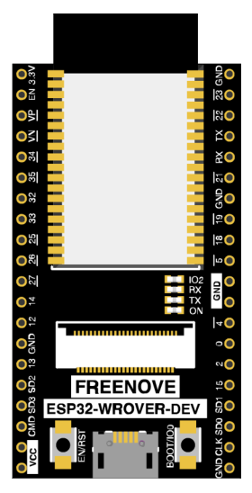 |
| Scheda di estensione GPIO (GPIO Extension Board) | 1 | 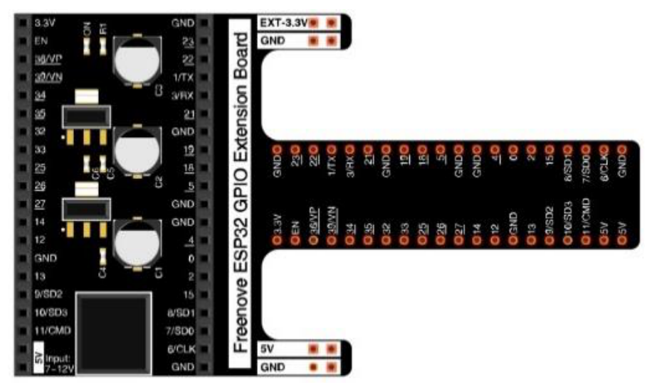 |
| Breadboard | 1 | 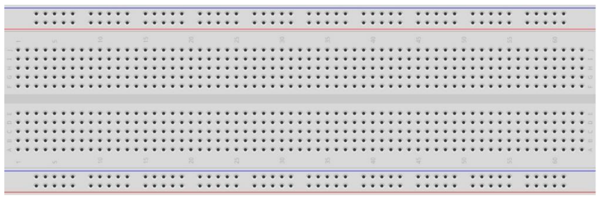 |
| Sensore di movimento HC-SR501 | 1 | 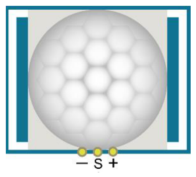 |
| LED | 1 | 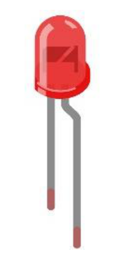 |
| Resistenza da 220 Ω | 1 |  |
| Cavetti jumper F/M (femmina-maschio)<br>Cavetti jumper M/M (maschio-maschio) | 3<br>2 | 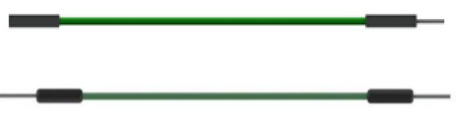<br>*in alto F/M, in basso M/M* |

### Conoscenze sul componente

Ecco come è fatto il sensore di movimento a infrarossi (HC-SR501):

| Vista dall'alto | Vista dal basso | Simbolo schematico |
|:---:|:---:|:---:|
| 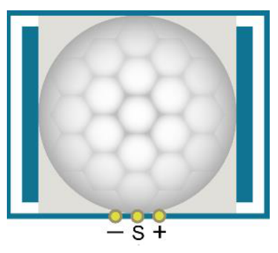 | 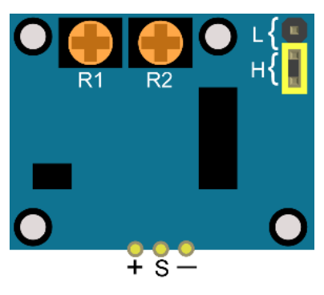 | 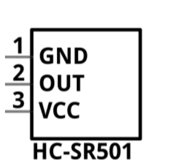 |

**Descrizione:**

**Tensione di funzionamento:** 5 V – 20 V (DC). **Corrente a riposo:** 65 µA.

**Attivazione automatica.** Quando un corpo vivente entra nell'area di rilevamento del sensore, il modulo porta l'uscita a **livello alto (3,3 V)**. Quando il corpo esce dall'area di rilevamento, l'uscita resta alta ancora per un tempo T, poi passa a **livello basso (0 V)**. Il tempo di ritardo T si regola con il potenziometro **R1**.

A seconda della posizione del ponticello (jumper) si può scegliere tra la modalità di attivazione **non ripetibile** e quella **ripetibile**.

**L: modalità di attivazione non ripetibile.** Dopo aver rilevato un corpo, il modulo porta l'uscita a livello alto; finito il tempo di ritardo, la riporta a livello basso. Mentre l'uscita è alta, il sensore non rileva più altri corpi.

**H: modalità di attivazione ripetibile.** A differenza della modalità L, mentre l'uscita è alta il sensore continua a rilevare il corpo finché questo non si allontana. Solo allora inizia a contare il tempo e, trascorso il ritardo T, porta l'uscita a livello basso.

**Tempo di blocco del rilevamento:** dopo aver portato l'uscita a livello alto o basso, il sensore resta bloccato e ignora i segnali esterni per brevi intervalli di tempo (inferiori al tempo di ritardo).

**Tempo di inizializzazione:** dopo l'accensione il modulo ha bisogno di circa **1 minuto** per inizializzarsi. In questo periodo l'uscita passa alternativamente dal livello alto a quello basso.

Una caratteristica di questo sensore è che la sensibilità è massima quando un corpo si avvicina o si allontana passando lungo il bordo della cupola del sensore. Se invece un corpo si avvicina o si allontana dalla cupola in direzione verticale, il sensore non lo rileva bene (attenzione a questo limite). Nota: il raggio di rilevamento (la distanza entro cui un corpo viene rilevato) si regola con il potenziometro.

In pratica possiamo considerare questo sensore come un semplice interruttore a induzione, cioè un interruttore che scatta quando rileva una presenza.

### Circuito

**Schema elettrico**

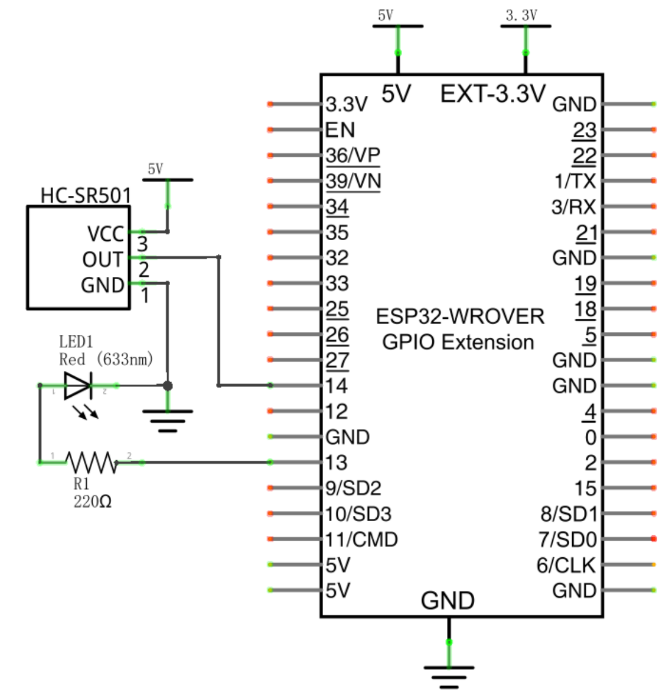

Riepilogo dei collegamenti (ricavato dallo schema):

| Da | A |
|---|---|
| HC-SR501 – VCC (pin 3, **+**) | 5V |
| HC-SR501 – OUT (pin 2, **S**) | GPIO 14 |
| HC-SR501 – GND (pin 1, **−**) | GND |
| GPIO 13 | resistenza R1 220 Ω → LED (anodo) |
| LED (catodo) | GND |

**Collegamento hardware.** Per qualsiasi supporto potete contattare Freenove all'indirizzo: support@freenove.com

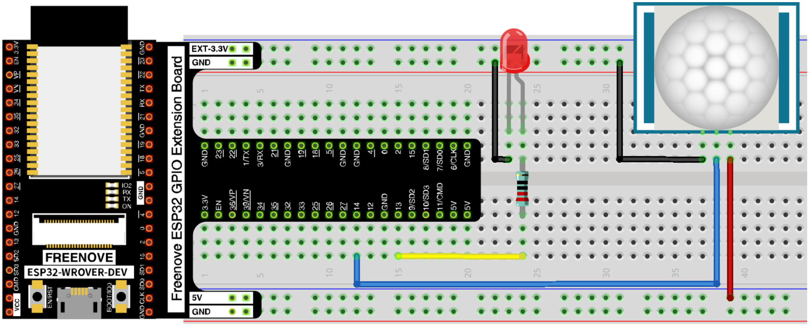

### Codice

In questo progetto usiamo il sensore di movimento a infrarossi per comandare un LED: in pratica il sensore funziona come un interruttore azionato dal movimento. Per questo il codice è simile a quello del progetto "Button & Led" (Pulsante e LED). La differenza è che il sensore porta l'uscita a livello alto quando rileva una variazione, e a livello basso quando non rileva nulla. Quando l'uscita del sensore è alta il LED si accende, altrimenti il LED si spegne.

Prima di iniziare, sposta la cartella dei programmi "**Freenove_Ultimate_Starter_Kit_for_ESP32/Python/Python_Codes**" sul disco D, in modo che il percorso diventi "**D:/Micropython_Codes**".

Apri "Thonny" e clicca su "This computer" → "D:" → "Micropython_Codes" → "25.1_Infrared_Motion_Detector", poi fai doppio clic su "Infrared_Motion_Detector.py".

#### Infrared Motion Detector

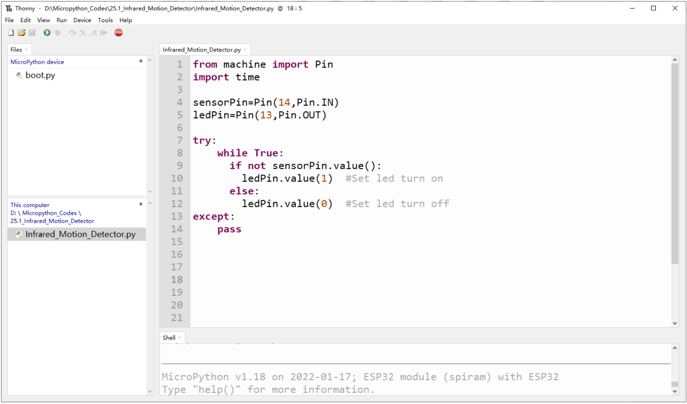

Codice del file `Infrared_Motion_Detector.py` (commenti tradotti):

```python
from machine import Pin
import time

sensorPin=Pin(14,Pin.IN)
ledPin=Pin(13,Pin.OUT)

try:
    while True:
        if not sensorPin.value():
            ledPin.value(1)  # Accende il LED
        else:
            ledPin.value(0)  # Spegne il LED
except:
    pass
```

Clicca su "Run current script" (esegui lo script corrente). Appoggia il sensore su un tavolo, senza muoverlo, e aspetta circa un minuto. Poi prova ad allontanarti o ad avvicinarti al sensore e osserva se il LED si accende o si spegne automaticamente.

Puoi ruotare i potenziometri del sensore per regolare il rilevamento, oppure cambiare modalità spostando il ponticello (jumper). *(Approfondimento: vedi [Appendice A](#appendice-a-regolazione-dei-potenziometri).)*

<p align="center">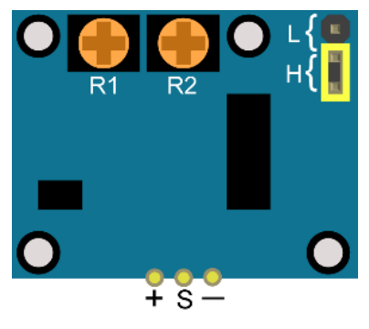</p>

Inoltre, modificando il codice, puoi usare questo sensore per comandare altri moduli e realizzare funzioni diverse, come una lampada o una porta che si attivano al passaggio di una persona.

**Avvicinati al sensore di movimento a infrarossi** (il LED si accende)

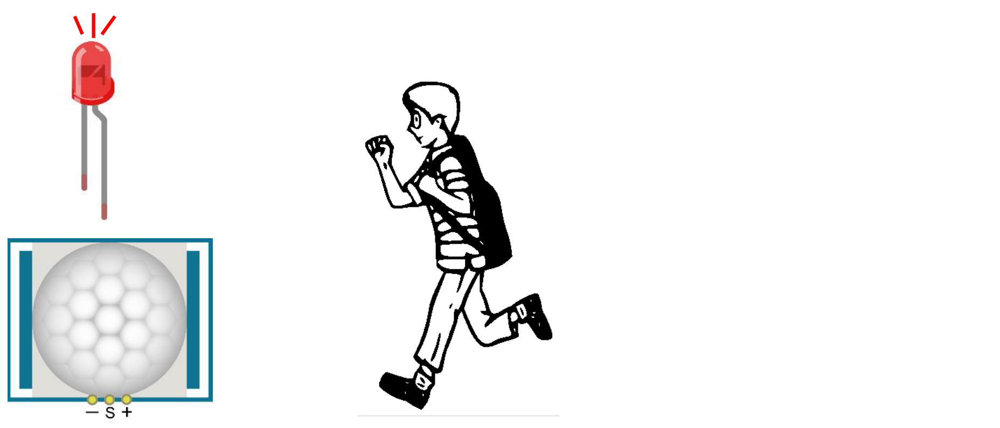

**Allontanati dal sensore di movimento a infrarossi** (il LED si spegne)

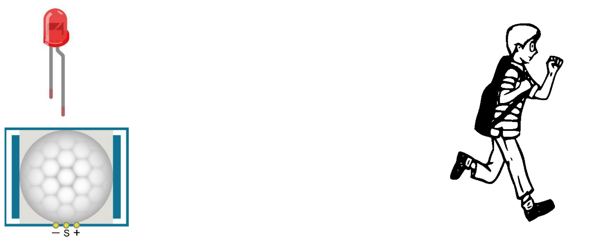

---

> **Nota del traduttore (non presente nell'originale).** Il testo dice che il LED si accende quando l'uscita del sensore è alta, ma nel codice la condizione è `if not sensorPin.value():`. Così com'è, quindi, il programma accende il LED (`ledPin.value(1)`) quando l'uscita del sensore è **bassa**, cioè quando *non* c'è movimento: il contrario di quanto descritto. Se durante la prova il LED si comporta al contrario, cambia la riga 9 in:
>
> ```python
>         if sensorPin.value():
> ```

---

## Appendice A: regolazione dei potenziometri

*Approfondimento aggiunto alla traduzione, non presente nell'originale.*

Sul retro del sensore ci sono due potenziometri, **R1** e **R2**, accanto al ponticello **L/H**. Sono piccoli trimmer che si girano con un cacciavite piccolo, e regolano due cose diverse.

<p align="center"></p>

| Potenziometro | Cosa regola | Effetto pratico |
|---|---|---|
| **R1** | **Tempo di ritardo T** | Per quanto tempo l'uscita resta alta (LED acceso) dopo che il movimento è finito |
| **R2** | **Distanza (sensibilità)** | Quanto lontano deve essere una persona per essere rilevata |

Il capitolo Freenove nomina esplicitamente solo **R1** per il tempo. Per la distanza dice solo "si regola con il potenziometro": essendo R1 già usato per il tempo, è **R2**.

### R1: il tempo di ritardo

Quando una persona esce dall'area di rilevamento, l'uscita non torna subito a 0 V: resta alta ancora per il tempo **T**, poi si abbassa.

- **T corto:** il LED si spegne poco dopo che la persona se n'è andata.
- **T lungo:** il LED resta acceso più a lungo, come una luce delle scale.

Di solito T va da qualche secondo a qualche minuto, a seconda del modello.

Nel nostro progetto il programma non gestisce nessun tempo: copia soltanto lo stato del sensore sul LED. Quindi **la durata del LED acceso la decide R1, non il codice.**

### R2: la distanza

Regola fin dove arriva il rilevamento, tipicamente da circa 3 a circa 7 metri.

- **Al minimo:** reagisce solo se ci si avvicina molto.
- **Al massimo:** reagisce anche a movimenti lontani, ma aumenta il rischio di falsi allarmi.

### Il ponticello L/H, che lavora insieme a R1

- **L (non ripetibile):** il sensore scatta e resta alto per il tempo T, anche se nel frattempo ci si continua a muovere. Poi si abbassa e solo dopo può scattare di nuovo.
- **H (ripetibile):** finché c'è movimento il tempo T riparte da capo, e il LED si spegne solo T secondi dopo l'ultimo movimento. È la modalità adatta a una lampada che deve restare accesa finché c'è qualcuno.

### Consigli pratici per la prova in classe

1. **R1 al minimo:** così non si devono aspettare minuti per vedere il LED spegnersi.
2. **R2 a metà:** è un buon punto di partenza.
3. **Ponticello su H:** il comportamento è più intuitivo.
4. **Aspettare circa 1 minuto dopo l'accensione:** il sensore si sta inizializzando e il LED può accendersi e spegnersi da solo.
5. **Blocco dopo lo spegnimento:** per qualche istante il sensore non rileva nulla. È normale, non è un guasto.

### Attenzione al proprio modulo

- **Posizione dei trimmer:** non tutti gli HC-SR501 hanno R1 e R2 nella stessa posizione del disegno Freenove. Alcuni li chiamano "Tx/Sx" o "TIME/SENS", altri non hanno scritte.
- **Senso di rotazione:** anche il verso che aumenta il valore può cambiare tra un modulo e l'altro.

Nel dubbio, si può fare una prova: girare un trimmer e osservare cosa cambia. Se cambia quanto resta acceso il LED, è il **tempo**; se cambia la distanza a cui il sensore rileva, è la **sensibilità**. I trimmer hanno un fine corsa: non vanno forzati oltre.

---

*Traduzione italiana del Capitolo 25 (pp. 276–280) del tutorial Python del "Freenove Ultimate Starter Kit for ESP32", © Freenove, rilasciato con licenza [Creative Commons Attribuzione – Non commerciale – Condividi allo stesso modo 3.0 Unported (CC BY-NC-SA 3.0)](https://creativecommons.org/licenses/by-nc-sa/3.0/). Questa traduzione è distribuita con la stessa licenza. Freenove® è un marchio di Freenove Creative Technology Co., Ltd.*
